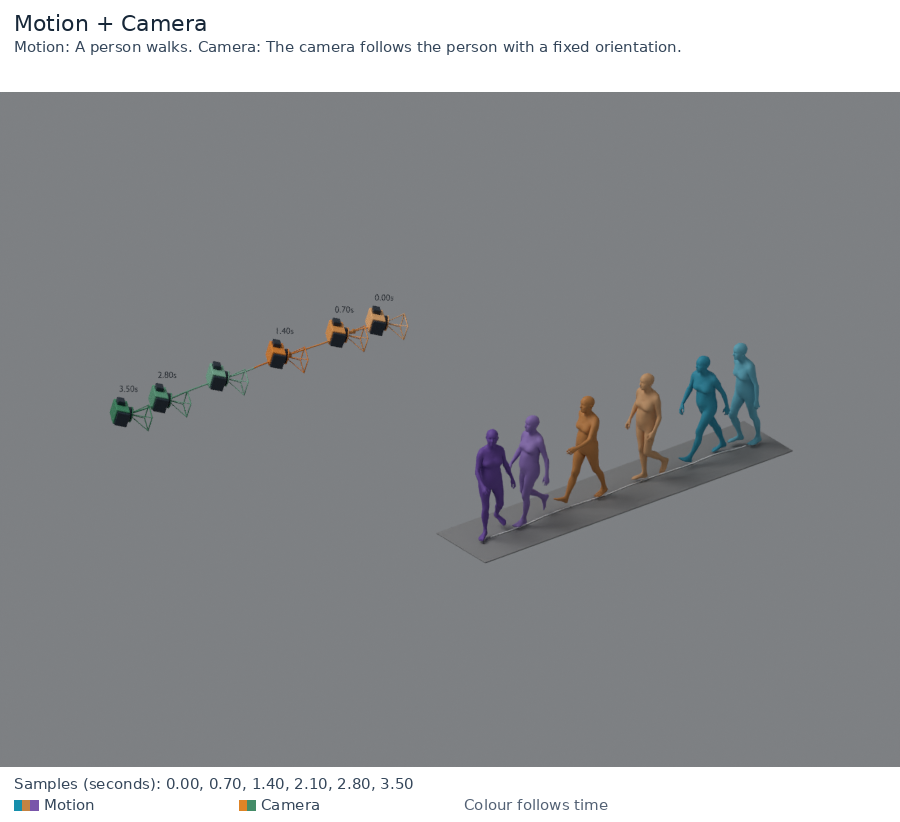
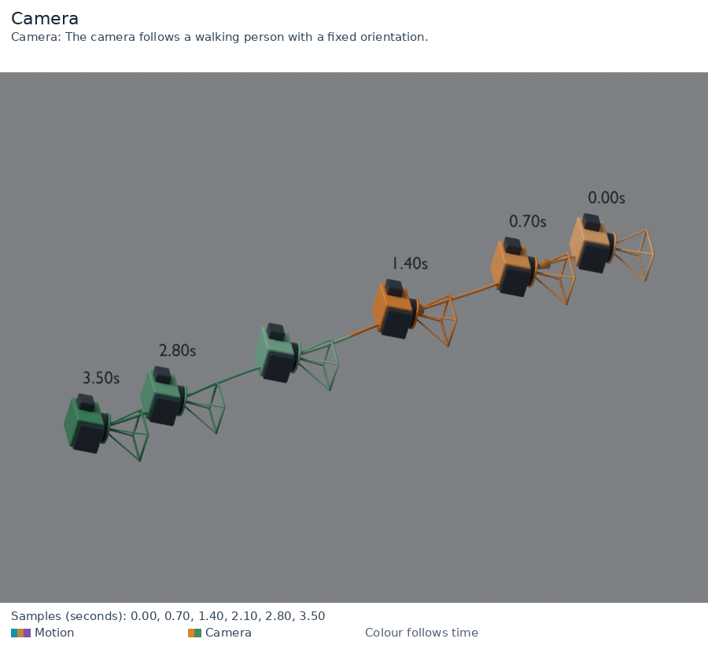
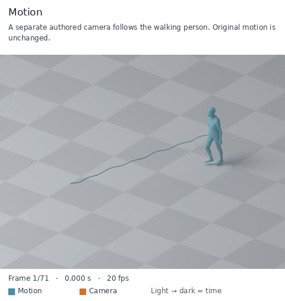

# motion-bpy-visulizer

A Blender visualizer for **Motion**, **Camera**, and **Motion + Camera** on one shared timeline.

| Mode | Temporal montage | MP4 / GIF | Editable `.blend` |
| --- | --- | --- | --- |
| `motion` | Body poses and root path | Animated SMPL-family mesh | Yes |
| `camera` | Calibrated camera frusta and trajectory | Moving camera glyph | Yes |
| `motion-camera` | Both modalities | Both, with optional input-camera view | Yes |

By default each modality has one configurable hue; optional palettes enable multiple simultaneous colours. Light → dark follows time. The world-view observer is a separate presentation camera. Imported camera poses, intrinsics, motion, world translation and timestamps are preserved. This tool visualizes camera data; it does not generate camera trajectories, repair framing, or add tracking.

## Demos

[**Browse the 22-demo gallery**](https://huzhongyyuan.github.io/motion-bpy-visulizer/demos/) · [Offline gallery](docs/demos/index.html) · [Media attribution](docs/ASSETS.md)

All human demos use SMPL-H meshes. The gallery covers Motion / Camera / joint views, both camera appearances, time gradients, multicolour palettes, transparent PNGs, keyframes, fixed cameras and orbiting cameras. Each still includes its Prompt.

| Motion + Camera | Two camera styles |
| --- | --- |
|  |  |



## Install

Python 3.10+, NumPy, Pillow; **Blender 3.6 LTS or 4.x**; FFmpeg and ffprobe for video/GIF.
Blender and FFmpeg are separate applications and are not bundled.

```bash
git clone https://github.com/huzhongyyuan/motion-bpy-visulizer.git
cd motion-bpy-visulizer
python -m venv .venv
source .venv/bin/activate
python -m pip install -e .
```

Render your already reconstructed SMPL-family **world-space mesh** and camera:

```bash
motion-bpy-visulizer render --motion smpl_world_mesh.npz --camera camera.npz \
  --mode all --blender /path/to/blender --out outputs/demo --camera-view \
  --motion-color '#168fac' --camera-color '#d77422' \
  --prompt 'A person walks while the camera follows.'
```

Open `outputs/demo/index.html`. Each selected world-view mode produces `temporal_raw.png`, captioned `temporal.png`, `animation.mp4`, `animation.gif`, and `scene.blend`. The optional input-camera view exports animation. Choose a **new** output directory for every run.

```bash
# Motion only: no camera input needed.
motion-bpy-visulizer render --motion smpl_world_mesh.npz --mode motion \
  --blender /path/to/blender --out outputs/motion
# Camera only: no human input needed.
motion-bpy-visulizer render --camera camera.npz --mode camera \
  --blender /path/to/blender --out outputs/camera --camera-style wire
# Joint montage only, with a solid camera icon.
motion-bpy-visulizer render --motion smpl_world_mesh.npz --camera camera.npz \
  --mode motion-camera --blender /path/to/blender --out outputs/joint \
  --outputs sequence,blend --camera-style icon
```

Default rendering uses **CPU only**. For a quick preview, add `--resolution 384 --render-samples 4`; increase both for export. [Step-by-step usage and styling](docs/USAGE.md) · [中文说明](README.zh-CN.md).

The optional `camera-view` is the actual input camera image. A stationary camera or sideways truck may lose the subject: this is displayed faithfully. Selecting the `camera` mode means visualizing camera geometry in the world, not generating scene content for that camera.

## Inputs

See [input contract](docs/INPUT_FORMAT.md). The canonical format is safe NPZ with explicit arrays; no body-model package, model weights, `.pkl` execution, or private dataset is required. Convert SMPL/SMPL-X output to `vertices/faces` upstream under its own license.

## Validation and evidence

```bash
python -m unittest discover -s tests -v
```

Each render records `job.json`, `run.json`, `blender.log`, and `blender_audit.json`. Before rendering, Blender checks every integer frame against the imported geometry and source camera, including pixel projection against K. Video frame count, fps, full decode, input hashes, and output hashes are checked. These prove rendering fidelity within the stated tolerances; they do not certify camera aesthetics, visibility, camera safety, or source motion quality.

See [validation notes](docs/VALIDATION.md) for actual tested versions and runs.

## Scope and limits

- Exactly matched clocks and frame counts; no automatic resampling, canonicalization, floor snapping, root recentering, smoothing or camera following.
- Triangular mesh sequences or joint/edge skeletons; Y-up or Z-up; OpenGL/OpenCV cameras; explicit c2w/w2c.
- Pinhole K, dynamic focal/principal point; fixed pixel aspect. No lens distortion, skew, rolling shutter, depth of field or dual-stream compositor.
- Sequence montage samples the clip uniformly; it is not motion retargeting or interpolation. Blender interpolates between samples for interactive playback, and frame-indexed exports use the exact samples.
- GIF timing uses centiseconds and cannot exactly express every fps. MP4 retains the requested frame rate.
- Long clips/high-resolution meshes can create large `.blend` files and take time to render. Choose montage-only for quick inspection.

## License

Original tool source, documentation and procedural test fixture: [MIT](LICENSE). Rendered human demo attribution and terms: [ASSETS.md](docs/ASSETS.md). Blender/FFmpeg retain their own licenses. No third-party body models, datasets, private source clips, or pretrained weights are included. Importing a file does not grant rights to redistribute it.

## Transparent PNGs

Use `--transparent` for RGBA PNGs (including annotated PNGs). It defaults to `--ground none`; choose `--ground checker` explicitly if a visible floor is desired. `temporal_raw.png` has no text, `temporal.png` includes labels. Animated PNG frames retain alpha. MP4 and GIF previews are explicitly flattened onto white; they are not transparent video formats.

`--root-path-space ground` projects only the displayed root path onto the presentation ground plane. It never modifies imported mesh, joints, root motion, or cameras. Default `world` retains true root height.

## Temporal style controls (v0.2)

Each modality retains one hue by default. `--lighten 0.8` controls the white mix at the beginning; `0` gives a solid colour. `--time-direction reverse` reverses the progression and `--time-gamma` adjusts its pace. Explicit `--motion-start-color` / `--camera-start-color` override the early colours. Colours depend on clip time, not sample rank.

Use `--sample-frames 0,10,20` for zero-based samples. Optional `--keyframes 10` adds emphasized samples (`--keyframe-color`, grey by default); otherwise highlighting is disabled. `--show-paths both|motion|camera|none` controls display curves, and modality-specific `--motion-path-color` / `--camera-path-color` fix their colours. `--ground solid --ground-color '#555b63'` creates a finite presentation plate. These options combine with transparent PNG output; a visible solid plate remains opaque.

Pose ghosts remain in their original world positions. No spatial offsets, motion edits or automatic tracking are introduced to avoid overlapping poses. Ground paths show the root projection, not detected footprints.

## Multiple simultaneous temporal colours (v0.3)

`--motion-palette '#168fac,#c58342,#7955aa'` assigns multiple colours across the timeline; `--camera-palette` is independent. `--palette-mode segments` uses equal-duration colour groups, each with a light-to-dark ramp. `smooth` interpolates between colour stops. Omitting palettes retains the single-hue style. Per-modality palettes and explicit start colours are mutually exclusive; keyframe emphasis and fixed path colours override palette values when requested.

Solid stages align to the horizontal principal axis of the full input geometry and fit its envelope. Use `--ground-color '#969696' --ground-padding .22 --ground-thickness .02` for a thin grey presentation stage. Padding is in metres per side; thickness extends below the top plane. Imported motion and cameras do not move. Display root paths sit just above the stage to avoid z-fighting.

### Camera presentation

The default `--camera-style icon` combines rounded 3D camera bodies, a graphite lens/grip, wire frustum glyphs, trajectory arrowheads and up to five time labels. Colours follow the existing independent camera palette. `--camera-scale 1.2` adjusts display glyph size only. Use `--camera-style wire` for the original wire glyph, `--camera-labels none` to hide timestamps, and `--no-camera-arrows` to hide direction markers. Stationary trajectories have no translation arrows. Source camera pose/K and actual camera-view rendering remain unchanged.

`--frustum-depth-ratio 0.55` (default) makes the display pyramid flatter: its base rectangle stays the same while its optical-axis length is 55% of the original. This is a stylized diagram; use `1` for a geometrically calibrated frustum. This setting affects live and montage glyphs only, never source K, pose, motion or camera-view pixels.

### Demo library

The delivered human demos use the existing reconstructed SMPL-H meshes. Generate new camera proposals around an existing mesh with `python examples/make_smpl_showcase.py --input smpl_mesh_camera.npz --out new_inputs`. The script preserves all motion arrays and the original clock. It does not load body-model weights or reconstruct meshes.

The [curated offline gallery](docs/demos/index.html) contains three modes, two camera styles, time colours, keyframes, transparency, fixed cameras and orbiting cameras. Each normal render also creates its own `index.html`. Every still includes an English Prompt; each gallery entry includes Chinese copy and the matching Prompt. [Demo copy](docs/DEMO_COPY.zh-CN.md).

Exactly repeated montage poses are shown once, with emphasized keyframes taking priority. Time labels at identical camera centres become one time range. Source frames and animation remain intact; distinct orientations or intrinsics at the same centre remain separate glyphs.

## Naming compatibility

The public name, repository, Python distribution and main CLI are `motion-bpy-visulizer` (spelled as shown). The existing `motionmontage-viz` command remains an alias; the Python import namespace `motionmontage_visualizer` is retained for compatibility. v0.4.3 is a naming/documentation release; the demo renders retain their original version records.
