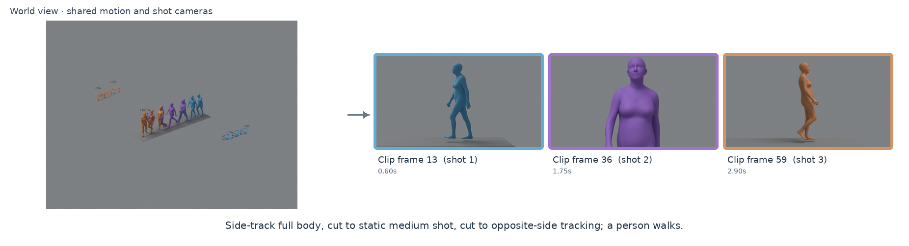
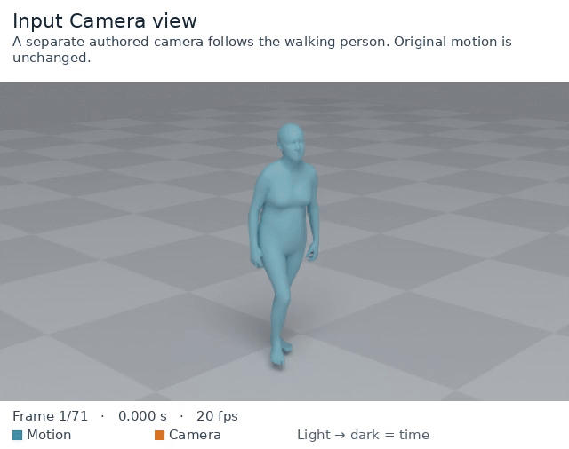
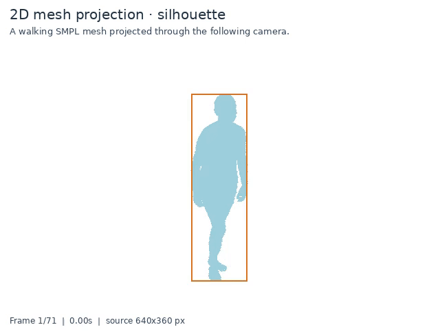
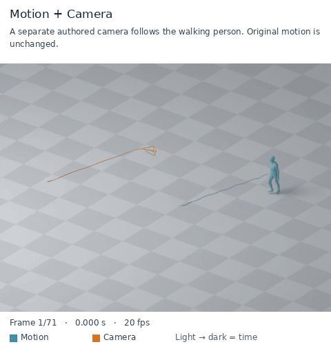
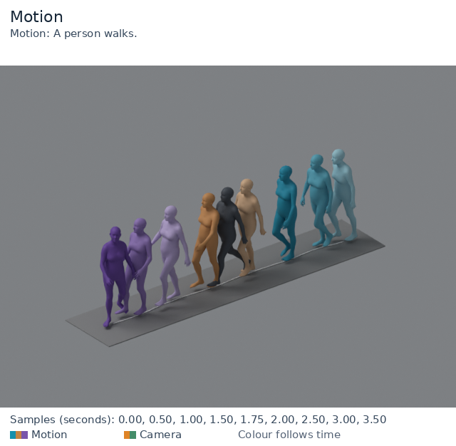
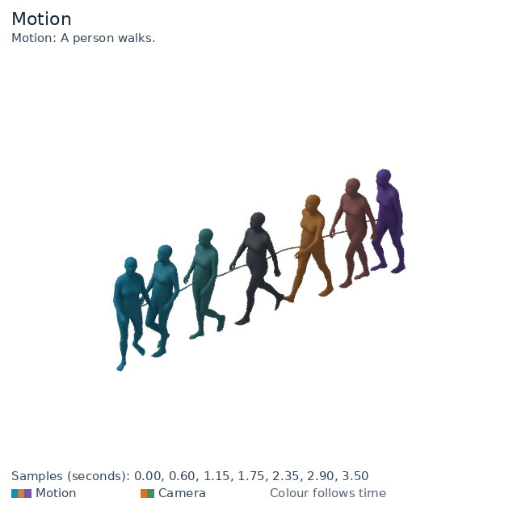
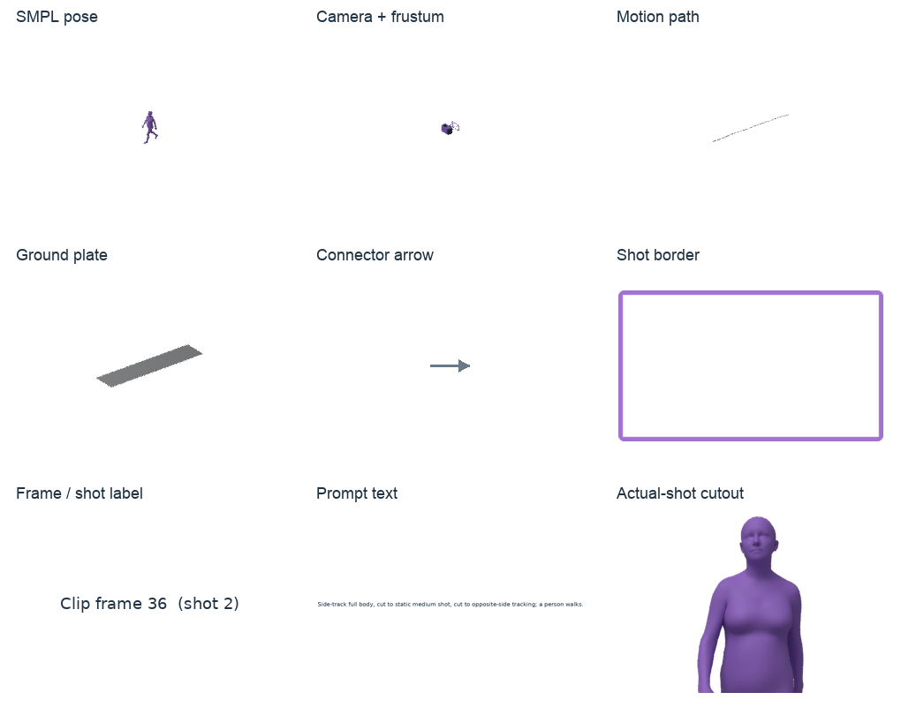

# motion-bpy-visulizer

同一套 Blender 工具，支持 **单独 Motion、单独 Camera、Motion + Camera 联合展示**。

- 每类都能导出时序叠加图、MP4、GIF 和可编辑 `.blend`。
- 人体和相机默认各一个色系，也可分别使用多色调色板；由浅到深表示时间。
- 左右移动、转向、焦距均来自实际输入；展示用观察相机单独存在。
- 可额外输出真实 Camera 看到的画面，便于判断跟拍、出画和构图。
- 不重置人体 root，不把相机自动改成跟拍，不修改输入。

## Demo

[在线查看全部 Demo](https://huzhongyyuan.github.io/motion-bpy-visulizer/demos/) · [离线总览](docs/demos/index.html)

28 个示例、26 张图、11 段视频；人体均使用 SMPL-H 网格。两种相机外观、透明背景、时序渐变、多色、关键帧及固定/环绕机位都有示例。[媒体来源与许可](docs/ASSETS.md)。

## 更多示例



| 实际相机视角 | 2D 网格投影 |
| --- | --- |
|  |  |
| **SMPL 联合动画** | **2D 网格线** |
|  |  |
| **多色关键帧** | **透明时序图** |
|  |  |

新增 `motion-bpy-visulizer project`：轮廓、网格线、网格顶点投影及像素坐标 UV 导出。新增 `render --storyboard --shot-boundaries ...`：左侧世界总览，右侧每镜真实画面，同色对应并标注帧号、Shot 和 Prompt。硬切处不连接相机轨迹。[完整用法](docs/USAGE.md)。

## 使用

安装 Python 依赖，并准备 Blender 与 FFmpeg：

```bash
git clone https://github.com/huzhongyyuan/motion-bpy-visulizer.git
cd motion-bpy-visulizer
python -m venv .venv
source .venv/bin/activate
python -m pip install -e .
motion-bpy-visulizer render --motion /你的路径/smpl_world_mesh.npz \
  --camera /你的路径/camera.npz --mode all \
  --blender /你的路径/blender --out outputs/demo --camera-view \
  --motion-color '#168fac' --camera-color '#d77422'
```

打开输出目录的 `index.html`，即可查看三类结果。单独模式用 `--mode motion` 或 `--mode camera`，并分别提供 `--motion xxx.npz`、`--camera xxx.npz`。只需要时序图时用 `--outputs sequence`。

输入格式见 [INPUT_FORMAT.md](docs/INPUT_FORMAT.md)：人体使用已经从 SMPL 系列重建好的世界坐标网格 `vertices/faces`；相机使用逐帧 `c2w/K`。交付 Demo 不使用骨架替代人体。支持 Y-up、Z-up，以及 OpenGL、OpenCV 相机约定。两类输入必须有一致的帧数和时间，不做隐式重采样。

这是渲染工具，不能以“成功生成视频”证明原相机质量合格。输入相机若没有跟随人体，视频会如实显示人物出画。

源码及程序生成的示例采用 MIT 协议。SMPL 系列模型、第三方数据和私人动作不包含在开源包内，仍遵循各自许可。完整配置与限制见 [英文文档](README.md)。

## 透明图与地面轨迹

加 **`--export-elements`** 可分开导出每个采样时刻的人体、相机、路径、地板、箭头、时间标签，以及分镜面板、边框和文字。全部使用带 Alpha 的 PNG，同时提供完整画布、紧裁切图、位置偏移记录及 ZIP 下载。[逐元素提取](docs/USAGE.md#9-extract-transparent-editing-elements)。MP4/GIF 预览为白底；透明动画使用 PNG 序列。



[下载 3D／分镜透明元素](docs/demos/assets/transparent_elements.zip) · [下载 2D 人体／框线透明元素](docs/demos/assets/projection_elements.zip)。

```bash
motion-bpy-visulizer render --input combined.npz --mode all \
  --blender /你的路径/blender --out outputs/transparent \
  --transparent --root-path-space ground --outputs sequence,blend
```

`--transparent` 导出真正带 Alpha 通道的 PNG，默认移除地板；`temporal_raw.png` 是无文字的透明图，`temporal.png` 保留标题与图例。动画逐帧 PNG 也保留透明背景。普通 MP4 和本工具的 GIF 预览使用白色底，不含透明通道。

`--root-path-space ground` 将展示用 root 轨迹投影到地面，不改变人体、相机或真实 root。默认 `world` 保持轨迹真实高度。若需要地板，可显式加 `--ground checker`；此时地板本身会遮挡背景，不会变透明。

## 时序渐变与参考图样式（v0.2）

默认：每个模态一个色系，早期接近白色，后期达到指定颜色；颜色按原始帧时间计算，改变采样数量不会改变同一帧的颜色。默认关键帧强调关闭。

| 设置 | 参数 |
| --- | --- |
| 人体/相机末端颜色 | `--motion-color` / `--camera-color` |
| 自定义起始颜色 | `--motion-start-color` / `--camera-start-color` |
| 渐变方向 | `--time-direction forward` / `reverse` |
| 深浅对比 | `--lighten 0.8`，0 为纯色，1 从白色开始 |
| 渐变节奏 | `--time-gamma 1`，大于1延后加深，小于1提前加深 |
| 指定展示帧 | `--sample-frames 0,10,20,30`，从0开始 |
| 强调关键帧 | `--keyframes 20`，默认灰色；可用 `--keyframe-color` 修改 |
| 轨迹显示 | `--show-paths both` / `motion` / `camera` / `none` |
| 固定轨迹色 | `--motion-path-color` / `--camera-path-color` |
| 地板 | `--ground checker` / `solid` / `none`；`--ground-color` 设置实心地板色 |

参考图风格示例（输入至少71帧）：

```bash
motion-bpy-visulizer render --input combined.npz --mode all \
  --blender /你的路径/blender --out outputs/reference \
  --sample-frames 0,10,20,30,40,50,60,70 --keyframes 35 \
  --motion-color '#168fac' --lighten 0.8 \
  --ground solid --ground-color '#555b63' \
  --root-path-space ground --motion-path-color '#ffffff' \
  --outputs sequence,blend
```

灰色人体是用户指定的关键帧强调，不是多余人物；所有姿态仍在其原始世界坐标中叠加。原地动作可能互相遮挡，工具不通过移动人体来“排开”它们。地面轨迹是 root 投影，不是脚印检测。

## 同时使用多种颜色（v0.3）

`--motion-palette '#168fac,#c58342,#7955aa'` 按时间使用青、金、紫三组颜色，Camera 可以独立指定 `--camera-palette`。

- `--palette-mode segments`：等长时间段分别使用一种颜色，每段内部由浅到深。
- `--palette-mode smooth`：在多个颜色之间连续插值。
- 默认不提供 palette 时，保留原来的单色系渐变；已有关键帧强调、渐变方向与 gamma 仍然适用。调色板与同一模态的 start-color 不能同时指定。

参考地板使用 `--ground solid --ground-color '#969696' --ground-padding .22 --ground-thickness .02`：矩形台面按整段运动的水平主轴对齐，尺寸包住原始人体，并保留每边22厘米余量；顶面不变，厚度向下延伸。`--motion-path-color '#ffffff' --root-path-space ground` 显示白色地面root轨迹。不会旋转、缩放或移动人体来适应地板。

```bash
motion-bpy-visulizer render --input combined.npz --mode all \
  --blender /你的路径/blender --out outputs/multicolour \
  --motion-palette '#168fac,#c58342,#7955aa' \
  --camera-palette '#df8426,#448c68' --palette-mode segments \
  --ground solid --ground-color '#969696' \
  --ground-padding .22 --ground-thickness .02 \
  --root-path-space ground --motion-path-color '#ffffff'
```

### 3D 相机外观

默认 `--camera-style icon` 使用圆角机身、石墨色镜头与握把，配合视锥图标、轨迹箭头和最多五个时间标签；支持原有相机调色板。`--camera-scale 1.2` 只调整展示模型大小。`--camera-style wire` 保留原线框，`--camera-labels none` 隐藏时间，`--no-camera-arrows` 隐藏方向箭头。静止机位不画平移箭头。输入相机位姿、内参和实际相机视角不变。

`--frustum-depth-ratio 0.55`（默认）保持线框底面宽高，只把前后纵深缩到原来的 55%，使锥形更扁。图标属于示意；设为 `1` 可恢复符合标定比例的视锥。静态时序图和动画同时生效，不改变真实相机内参、位姿、动作或相机视角画面。

### Demo 总览

交付的人体 Demo 使用SMPL-H 网格，不用骨架或程序小人代替。`python examples/make_smpl_showcase.py --input smpl_mesh_camera.npz --out new_inputs` 可围绕已有网格编写固定及环绕相机，保持动作数组和原始时间不变；不加载模型权重、不重新重建人体。

[离线 Demo 总览](docs/demos/index.html) 涵盖三类模态、两种相机外观、时序配色、关键帧、透明背景、固定机位和环绕机位。每张时序图写英文 Prompt，网页提供中文说明和对应 Prompt。[逐例文案](docs/DEMO_COPY.zh-CN.md)。

时序图中完全相同的姿态只展示一次，优先保留强调关键帧；原始帧和动画不变。机位中心完全相同的时间标签合并成时间范围，同一机位的不同朝向或内参仍分别展示。

## 名称兼容

对外名称、仓库、安装包和主命令统一为 `motion-bpy-visulizer`，拼写按此名称保留。旧命令 `motionmontage-viz` 仍可使用；Python 导入命名空间 `motionmontage_visualizer` 保持兼容。v0.5.0 新增 2D 网格投影和分镜总览；既有 Demo 保留原来的渲染版本。
